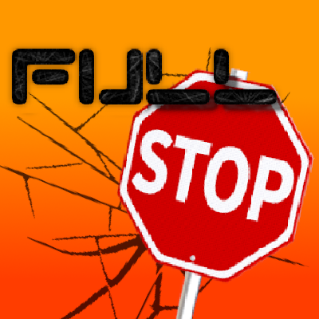

[Curseforge Page](https://www.curseforge.com/minecraft/mc-mods/full-stop)

[Modrinth Page](https://modrinth.com/mod/full-stop!-)

# 🛑 Full Stop!

NOTICE: This mod is in Beta. There will be many bugs! Please report all bugs on the issue tracker!

## Overview
Full Stop! makes velocity dangerous. Every sprint, dive, crash, and fall is measured, and the world pushes back: walls hurt at speed, blocks crack and shatter under hard impacts, boats skip across water, sand swallows divers whole, and the sky itself runs out of air if you climb too high. This mod is inspired by [Collision Damage by fonnymunkey](https://www.curseforge.com/minecraft/mc-mods/collision-damage) and started as a fork of [Velocity Based Damage Deluxe by kawaiicakes](https://www.curseforge.com/minecraft/mc-mods/velocity-based-damage-deluxe).

## Features

### Kinetic Physics
- 💥 **Dynamic Kinetic Damage:** Impact damage is calculated from real measured stopping force, factoring in mass, velocity, impact direction, block hardness, and armor. Fall damage, wall crashes, and ceiling hits all use the same system. Vanilla fall damage is replaced entirely.
- 🏃 **Velocity-Based Attack Scaling:** Speed is power. Attacks deal more damage when moving toward your target and less when retreating.
- 🧱 **Kinetic Block Breaking:** Become a wrecking ball. Fast, heavy entities crack and shatter blocks on impact. Fragile blocks like glass give way easily, but only to impacts that actually drive into them. Ice is tiered: impacts leave real, persistent cracks on the block (the mining-crack overlay), and cracked ice takes less to shatter. Cracks are permanent (and save with the world) unless you configure them to heal. A body wider than a block (a giant, a ravager, anything a size mod grew) leaves a hole the width of its feet: the whole footprint goes, and a bowl below it if the fall was hard enough.
- 🕳️ **Block Phasing and Engulfment:** At high speed you punch through leaves, and dive straight into sand, gravel, or snow. Engulfing blocks bleed off your speed and bury you inside. Dig or jump your way back out.
- 🪨 **Gravity-Affected Blocks:** Slime and honey blocks fall like sand when nothing supports them, and sticky blocks cling to neighbors on any face. A falling sticky block even grabs onto blocks it falls past. Never on a Valkyrien Skies ship (the ship holds its blocks as one body) and never in zero gravity.
- 🤼 **Entity Collisions:** Mobs, players and vehicles meeting faster than 10 m/s collide as two bodies: they trade momentum by mass and each takes the kinetic damage of the speed it lost, and a body landing on one crushes it. Every projectile meets every other in flight: arrows and tridents knock each other aside; eggs, snowballs, potions, fireballs, wither skulls and modded projectiles break or explode where they meet. Falling blocks collide too, at their block's mass. (The older experimental collisions, with landing on a mob or boat to ride it, are `entityCollisionDamage`: they run only with `enableEntityCollisions` off.)

### The World Reacts
- 🚪 **Kinetic Interactions:** Sprint into doors and fence gates to fling them open (only from the side they swing toward), crash into note blocks to play them, ring bells, press buttons by running into them (a projectile presses only the buttons vanilla lets arrows press: wooden ones, never stone), and turn grass to path by landing hard on it. Each interaction has its own config toggle.
- 🌪️ **Sand Blasting:** Falling sand strips logs and scrapes oxidation and wax off copper.
- 🟢 **Slime Bounce Overhaul:** Bounce off slime in *any* direction, walls and ceilings included, with optional camera rotation to match. A player's landing on slime bounces on the player's own client the moment it lands, so it bounces every time on a Valkyrien Skies ship's deck too (`playerSlimeLandingsOnClient`). Beds and honey have their own impact behavior.
- 🛟 **Slime and Honey Ships:** Valkyrien Skies ships bounce off slime too: a slime hull off anything, any hull off a slime floor or wall, slime against slime the bounciest - springing back at `slimeRestitution` (0.9) of the speed they hit with, ship against ship equally and oppositely. Honey sticks instead: no bounce, a softer crash, and the two are glued where they touched (the ground, or another ship: tow a ship by a honey face) until something pulls them apart harder than `honeyGlueStrength` - a strong push, a ram, an engine - a glued block breaks or the ship is disassembled. Glue survives unloading and restarts.
- 🌊 **Water Physics:** Skim across water at a shallow angle like a thrown stone (minecarts too), dive clean to survive, or belly flop and regret it. Underwater movement has extra drag and sound.
- 🍯 **Viscous Blocks:** Honey and the soul sand family slow you down while you move beside them, not just on top.

### The Body Reacts
- 😵 **G-Force Effects (G-LOC):** Sustained high-G maneuvers bring tunnel vision, muffled audio, and full blackout if you keep pushing — past the blackout you are blinded, with nausea that lingers after your sight returns. Spinning round and round for a while, or running in tight circles at speed, makes you dizzy (nausea) without blacking out - a quick turn or a busy mouse never does. FOV stretches with acceleration.
- 🫁 **Atmosphere and Pressure:** Air thins out at high altitude. Climb (or teleport) too high and your air supply drains, slowly at first, faster the higher and longer you stay. Deep water crushes and drowns you faster below configurable depths. Respiration is renamed **Better Breathing** and slows thin-air suffocation the same way it slows drowning.
- 🧪 **Status Effects:**
  - **Clarity:** Focus your mind to resist G-force effects.
  - **Vertigo:** Amplifies G-force penalties. Deadly in elytra combat.
  - **Sprain:** Land too hard and you'll limp for a while.
  - **Acclimation:** The high-altitude Water Breathing. Brew it with a Phantom Membrane and breathe easy in thin air.
- ⚖️ **Attributes:** Kinetic Dampening reduces impact damage (leather armor grants some naturally). Lung Capacity controls how long your breath lasts in thin air.
- ✨ **Enchantments:**
  - **Pullback:** The opposite of Knockback. Pull your enemies closer.
  - **Reflective:** Armor that throws kinetic energy back at whatever hits you.
  - **Kinetic Protection:** Specialized armor protection against high-velocity impacts.

### Quality of Life
- 💀 **Detailed Death Messages:** Death messages report the exact speed of the fatal impact.
- 🚢 **Valkyrien Skies Compatibility:** Riding a moving ship doesn't count as your own velocity, impacts against ship blocks are recognized, and hulls are solid at any speed - Valkyrien Skies on its own let anything moving faster than about a block a tick (a player flying at 22 m/s, a thrown mob) pass straight through a hull.
- ⚓ **Ship Weight** (formerly the WeightRS mod): what stands on a Valkyrien Skies ship weighs it down, jumping off kicks it, and landing on it slams it - as a two-body exchange with the ship's effective mass where you stand, so a heavy rider rocks a small raft instead of flipping it over. WeightRS's settings import automatically.
- ⛵ **Ship Collisions:** a moving ship knocks away and hurts what it hits (players included; the seated pilot gets the credit; at any speed - an 80 m/s ship launches a player at about 104 m/s, and the body of whatever it kills flies on), crushes what it pins, collides with whatever runs, flies or falls into it as two bodies (a golem hitting a light raft shoves it away and barely slows; a player hitting a big ship stops as at a wall and is hurt as much), and crashes into terrain the way its materials say: at each contact the weaker block gives, weighed by hardness and Valkyrien Skies' block mass. A stone hull crushes grass, a wooden hull rammed into stone splinters while the stone holds, obsidian against obsidian holds. Ships at speed plough through tree canopies and soft plants, and every impact sounds like both blocks that met - louder and higher-pitched the faster the hit.
- 🧶 **Soft blocks hit softly:** a hull's or a contraption's soft block (wool, hay, leaves, moss, sponge, carpets, beds: `#fullstop:cushioning`, `#fullstop:soft_landing`) deals a tenth of a strike's damage (`softStrikeDamage`) and springs back less, though it still carries what it hits along: a wool arm at 256 RPM shoves an iron golem at 100 m/s and takes 4 health off it, where an iron arm deals 140.
- 👊 **Punch a ship:** a fist (or a sword) hitting a block of a Valkyrien Skies ship gives it a small push at the point hit (`punchShips`, `punchShipImpulse` 250 N·s for a 75 kg player, more for heavier and bigger players): a one-block ship drifts off, a raft barely moves, a big ship not at all. Not while sneaking, with a tool, in creative, on the ship you stand on, or where you may not change blocks.
- 🛳️ **Ship Riders:** what rides a Valkyrien Skies ship keeps the momentum the ship loses. When a ship crashes, brakes, lurches, throws itself into a turn or spins up harder than riders can hold on (1 g by default), they keep the difference: a ship that stops dead throws its crew forward off the bow, into whatever it hit. A ship turning or spinning steadily - a Clockwork rotor at any speed - carries its riders round as Valkyrien Skies does: they stay where they stand. Riders anchored to the deck stay put: standing on slime or honey (`fullstop:sticky`), on Gravity Unbound's gravity plating, or clinging with its Surface Cling boots. Seated riders stay seated unless you say otherwise.
- ⚙️ **Create Catastrophes** (with Create; `enableCreateCompat`, Create section, on): every moving part of Create is dangerous. A moving contraption - a bearing's arm or windmill sail, a piston's or gantry's ram, a pulley's platform, a minecart contraption, a train - strikes what it runs into exactly as a ship's hull does (`contraptionImpacts`): the speed of the contraption's block at the point of contact against yours, the same knock-away, friction, lift, damage and crush against what's behind you, swept through the contraption's whole motion so a 256 RPM arm never passes through you. Slower than `gentlePushSpeed` it only pushes, as Create does; riding it or standing on it you're carried, never hit. Create's own train run-over damage stands down so nothing hurts twice (`contraptionsReplaceTrainDamage`). F3+V shows each moving contraption's coming path (red where it would strike a body) and each gear's and water wheel's catch ring, with a line from every caught body to where it's pulled.
  - **Terrain and ships, both sides giving** (`contraptionTerrainImpacts`, `contraptionBlocksBreak`, `contraptionImpactStress`, `contraptionShipImpacts`): a contraption moving at `contraptionTerrainMinSpeed` (5 m/s) or faster that runs into the terrain or a Valkyrien Skies ship breaks whichever block is weaker by the ship material rule - an iron arm carves stone, a wool sail hitting stone is knocked off the contraption and drops - and cracks what one hit can't break. The hit loads the network driving it with stress (`contraptionStressPerImpact` SU per energy unit, fading over about a second: a stressometer shows it), and a hit nothing gives way to (bedrock, a block too tough, a heavy or static ship) jams it: the contraption stops with its block against the obstacle and its network stays overstressed (everything on it stopped, nothing grinding) until you stop or reverse the motor or the obstacle goes. A bearing stopped while jammed sets its arm down at the last quarter turn it passed, never through the obstacle; a gantry sets itself down in front of it. Carts and trains lose speed instead and stop dead on a jam. A ship it hits is pushed at the contact. `contraptionImpactStrength` (4) scales how hard contraptions hit; slower contraptions pass through blocks as in Create.
  - **Death messages**: was caught in the gears / was ground up by a large cogwheel / was battered by a water wheel / was held under by a water wheel; was swatted by a spinning contraption / was swatted by a windmill / was swept away by a clock's hands / was rammed by a mechanical piston / was run down by a gantry / was struck by a pulley platform / was struck by an elevator / was run over by a minecart contraption / was hit by a train / was struck by a contraption; each contraption also "was crushed between a <kind> and a wall" (pulleys and elevators: "was flattened by"), "was crushed between a <kind> and a ship", and names the driver when there is one ("was hit by Steve's train").
- ⚙️ **Gears and water wheels** (with Create; `gearHazards`, `waterWheelHazards`, on): where two gears mesh, the nip on their in-running side (where both gears' teeth run into the mesh) draws in whoever gets caught in its mouth and crushes them, harder the faster it turns, and the body jams the gears: it loads their network with stress (`gearJamStress`), so a big body or a weak network overstresses and stops, the body wedged until it gets out. A single spinning gear never pulls and never hurts: touch its teeth and you're pushed off along the way they move, and a very fast one (its teeth past `gearFlingSpeed`: a cogwheel at 256 RPM, a large one from about 128) flings you like a ship's hull; only what you're thrown into, or land on, hurts. A turning water wheel sweeps you off its top into the water and holds you under its paddles until you drown, unless you swim out sideways along its axle. Encased cogwheels, gearboxes and shafts are safe; creative players are never caught (on foot a single gear still pushes or flings them).
- 💥 **Contraptions break the sound barrier** (with Create; `contraptionSonicBooms`, on): an arm whose tip passes 343 m/s (12.8 blocks out at 256 RPM) booms once for everyone the shock reaches, and keeps up a supersonic rotor's shock train while it spins.
- 🎠 **Turning with a turning contraption** (with Create; `contraptionRidersTurn`, on): stand on a bearing's turning plate or a carousel and your view turns with it, smoothly every frame, as on a Valkyrien Skies ship; a mob standing on it turns too (its body and head). Seated passengers are Create's own; a windmill or a sideways bearing turns nobody.
- 🏎️ **Plays well with movement mods:** mods that script an entity's motion (MKW Mobility's karts, grapples, meteors) claim it through Camafy's physics-ownership contract, and FullStop keeps its hands off whatever they claim - no crash damage, g-force effects, bounces, pushes or block breaking for a kart or its driver in a race. In free roam a kart is a vehicle like any other for crashes and ship hits: its driver shares its wall crashes, and a ship's push reaches the kart through Camafy's `Impulses` on the driver's own client.
- **Gravity Unbound Compatibility:** Impacts are measured in your gravity frame, so being pulled into a wall by a gravity field hurts like the fall it is, walls and floors are what the field says they are, and momentum exchanged with the mod stays in world space.
- 🪐 **Zero and Low Gravity:** Full Stop reads each entity's real local gravity through Camafy - Gravity Unbound's fields, VS Genesis's space dimensions, Ad Astra's orbits and planets, the `forge:entity_gravity` attribute - so space and the Moon behave. In zero gravity nothing is a fall: bumping into a floor is an impact like a wall (the wall threshold, no fall damage type, no Feather Falling, no sprain), a floating body weighs nothing on a ship, a deck has no grip on a floating rider and throws nobody upward, a hull meets a floating body alike from every side, you feel only your acceleration (no 1 g baseline), and loose slime, honey and dripstone don't fall. On the Moon grip, throw lift, hull-hit lift, standing weight and ride-stack load are a sixth, and landings are as gentle as their speed.
- 📦 **Data-Driven Tags:** Block behaviors (fragile, crackable, cushioning, phaseable, engulfing, gravity-affected, slowing, and more) are plain block tags under `data/fullstop/tags/`, so datapacks and other mods can customize everything without code. Entity tags too: blacklist modded entities from FullStop physics entirely (`fullstop:physics_blacklist`), or opt modded projectiles like grappling hooks into the full physics — bounces, block breaking, collision damage (`fullstop:physics_projectiles`).
- 🛠️ **Debug Mode:** Press `F3 + V` to visualize collision raycasts in real time. Red rays are collision-grade hits, yellow means touching, green is clear. Moving Valkyrien Skies ships show the same rays, from their corners, face centres and centre of mass along each point's velocity (so a turning ship's rays fan out). Projectiles show the path they swept this tick, as thick as their body, and a thinner line where they go next: cyan for arrows and tridents, orange for everything else, grey for one FullStop leaves alone.

### Advancements

A tab of its own (the elytra), each earned by something FullStop itself judged:

| Advancement | Earned by |
| --- | --- |
| Ouch, that hurts! | Your first kinetic damage |
| Terminal velocity | Landing from a fall at 50 m/s or faster, and living |
| Belly flop | Hitting the water flat, hard enough to hurt |
| Bouncy | Bouncing off slime at 20 m/s or faster |
| Crater maker | Your own impact opening a crater |
| Hit by a ship | A Valkyrien Skies ship's hit, survived |
| Flattened | Killed by a ship (hidden until it happens) |
| Boom | A sonic boom reaching you |
| Thunderscreech | Ten seconds within 32 blocks of a supersonic rotor's roar |
| Mid-air collision | Two of your own projectiles meeting in the air |

The triggers are plain criteria (`fullstop:<name>`), so a data pack can reuse them in its own advancements.

## Configuration
Nearly everything is tunable in the server config (per world: `<world>/serverconfig/fullstop-server.toml`): damage thresholds, block breaking (and the craters a wide body leaves: `impactCraters`, `impactCraterMaxRadius`, `impactCraterMaxDepth`), each kinetic interaction (doors, buttons, note blocks, bells, sand blasting), pressure simulation, phasing speed, and Valkyrien Skies / Gravity Unbound compat. Entity weights come from Camafy's shared weight model (`config/camafy-weight.toml`). The G-force thresholds (effect start, blackout, spin nausea: `spinNauseaThreshold`, 15 degrees a tick, and `spinNauseaTurns`, 2 turns of sustained spinning past it) are server settings — they are gameplay, shifted per player by the Clarity and Vertigo potions. Client config covers only the bounce camera (including an elytra-only mode).

With Valkyrien Skies installed (and `enableValkyrienSkiesCompat` on) two more sections apply:

- **Ship Weight** — `enableShipWeight` (master switch; stays off while the old WeightRS mod is installed), `includePlayers`, `gravity` (9.81 m/s²; VS pulls ships at 10), `minPhysicsWeightKg`, `enableItemEntityPhysics`, `enableStandingWeight`, `enableJumpImpulse`, `enableFallImpact`, `jumpImpulseMultiplier`, `fallImpactMultiplier`, `minFallDistance` (blocks), and `maxForceNewtons` — the cap on every force FullStop puts on a ship (an impulse is capped at a 1/60 s step of it).
- **Ship Collisions** — `enableShipCollisions` (master switch), `solidHulls` (on: fast entities can't pass through hulls), `entityImpacts` (on: entities hitting ships collide with them as two bodies), entities: `damageEntities`, `pushMinSpeed`, `hullFriction` (0.4), `hitLift` (0.3), `entityDamageMultiplier`, `entityRestitution`, `pinnedDamageMultiplier`, `creditPilot`, `reactionImpulses`; terrain: `breakTerrain`, `hullDamage` (on: a hull breaks where it hits tougher terrain), `massInfluence`, `breakMinSpeed` (5 m/s), `terrainEnergyFraction`, `breakCostMultiplier`, `terrainBreakDrag`, `terrainMaxBlocksPerTick`, `terrainBlockDrops`, `terrainBreakBlockEntities`, `unpilotedFollowsMobGriefing`, `shipVsShipBreaking` (NONE / FRAGILE / FULL, default FULL), `mutualBreakRatio` (1.25: blocks this close in toughness both break), `shipClashSweep` (on: hulls crossing each other between physics frames break, on both ships), `shipClashMaxBlocksPerTick` (96); vegetation: `sweepVegetation`, `sweepMinSpeed` (4 m/s), `sweepPlacedLeaves` (off), `sweepDrag`, `sweepMaxBlocksPerTick`; sound: `impactSounds`, `impactSoundMinSpeed` (1.5 m/s), `impactSoundVolume`, `impactParticles`; slime and honey: `slimeBounce`, `slimeRestitution` (0.9), `slimeMinSpeed` (2 m/s), `honeyGlue`, `honeyGlueStrength` (60 kN), `honeySoftening` (0.75); soft blocks: `softStrikeDamage` (0.1: a soft hull or contraption block's share of a strike's damage); punches: `punchShips` (on), `punchShipImpulse` (250 N·s); and `newShipGraceTicks`, `maxHitChecksPerTick`, `debugShipCollisionLog`, `debugShipContactLog` (off: logs every decision about a player touching a ship, on both sides - see below).
- **Ship Riders** — `deckMomentum` (master switch, on), `deckGrip` (9.81 m/s²: how hard a deck may change speed under a rider before it lets go), `deckThrowLift` (0.15: a thrown rider also gets this share of its kept speed as lift, so it leaves the deck instead of skidding), `deckMomentumSeated` (off: seated riders stay in their seats), `releaseLeavingRiders` (on: Valkyrien Skies lets go of a player the moment it leaves the deck - a jump, a step off, a hull knocking it away - and the player flies on the deck's momentum in a straight line, kept against air drag until it lands, instead of being carried round with the ship for another 25 ticks).

  A deck jolt only throws as far as it still stands in both of the next two physics frames (a Clockwork phys bearing swings its rotor's spin by a third either way and back as VS's physics steps fall unevenly between ticks), and not at all while VS's physics catches up after a stall (a hitch leaves a moving ship without a new frame for 0.1 s: the next 0.3 s aren't judged; a bearing then lurches its rotor round to catch up with its target angle). A frame VS reports as (almost) motionless while the ship's pose moved on as before is taken at its pose instead (VS reports a bearing's rotor as not turning for a frame now and then). Never by less than 1 m/s; a player gets it as a change to its own motion on its client. Riders keep what the deck under their feet lost in one physics frame, less `deckGrip` × the frame's length: `excess = lost × max(0, 1 − deckGrip·dt / |lost|)`. `lost` is measured in the ship's own frame - the deck's velocity under the rider a frame ago, turned with the ship, against its velocity now - because Valkyrien Skies turns the riders it carries with the deck: a steady turn or spin (its centripetal pull included) changes nothing, a stop, a lurch, a spin speeding up or slowing (`α × r`) or a turn starting does. Valkyrien Skies goes on carrying them at the deck's new speed, so in the world they keep their old speed less the grip. How far a thrown rider flies is vanilla's business (a mob or player loses 9% of its horizontal speed to air drag every tick): about 5 blocks from a 23 m/s stop. Never thrown: anchored riders (a `fullstop:sticky` block under the feet, or Camafy's `Gravity.isAnchored`: Gravity Unbound's plating and Surface Cling), seated riders (unless `deckMomentumSeated`), creative-flying players, NoAI mobs, `fullstop:physics_blacklist` entities and bodies another mod moves (MOTION claims: MKW karts, grappling players). A grounded rider never keeps velocity into its deck (a ship landing hard or rising fast presses it down; the deck holds it). Needs Camafy 0.1.3.

  What breaks when a ship hits terrain: every block has a **toughness**, its hardness × (Valkyrien Skies' mass for it ÷ 1000 kg)^`massInfluence` — leaves 0.04, grass 0.75, oak planks 1.0, logs 1.6, stone 3.75, cobblestone 4.8, deepslate 8.7, iron block 39, obsidian 250 (`fullstop:fragile` blocks such as glass count as hardness 0.01; unbreakable blocks are infinitely tough). Hardness alone would rank oak planks (2.0) above stone (1.5); the mass puts them right. At each contact only the WEAKER of the terrain block and the ship's own block there can break, at a cost of toughness(weaker) × `breakCostMultiplier` × r/(r−1) FullStop energy units (r = the toughness ratio; a unit is about 46 kJ): about toughness × 8 against a far tougher striker, a fortune for near-equal materials, never for equal ones. The ship's kinetic energy into the terrain pays, ½·m·v² × `terrainEnergyFraction` per tick, fastest contact first; nothing breaks below `breakMinSpeed`. With the defaults a 150 t wooden ship bumping stone at 3 m/s breaks nothing, at 8 m/s loses about four bow planks (the stone holds), and a 3×3×3 stone cube dropped ten blocks onto grass crushes the grass it lands on. When everything the ship hit gave way it ploughs on with what is left; when anything held, or its own hull gave way, it stays stopped. Broken blocks drop like mined ones, the hull's included. Ships hitting ships follow the same rule (`shipVsShipBreaking`, FULL by default): the weaker of the two blocks at each contact breaks, on either ship (an obsidian ship rammed into a wooden one breaks planks, never obsidian; two wooden ships only bump), out of the collision's energy with the pair's reduced mass - so a heavy ship ramming a light raft has only the raft's share to spend - and when everything struck gave, both plough on, slowed by what breaking cost. Two blocks within `mutualBreakRatio` (1.25) of each other in toughness both give when the energy is there: planks meeting planks at speed splinter both (two rafts bumping at walking pace still break nothing). And hulls that cross each other between two physics frames - the tips of two 256 RPM rotors move ten blocks a tick, and VS resolves ships only where they overlap at the end of a step - are found by following every block of the smaller ship along the path it took over the tick against the other's blocks (`shipClashSweep`): every pair of blocks that crossed breaks by the same rule, at the speed they met, on both ships.

  Ships held together by Valkyrien Skies' joints - a rotor on a Clockwork phys bearing and the ship it turns in, ships VMod welds or ropes, Camafy's joints, honey glue, and any chain of them - are one machine: FullStop never judges a touch between them as a crash, a clash, a slime bounce or a deck jolt (Camafy's `Ships.joined`).

  Vegetation: VS lets ships pass straight through leaves, so a ship moving at `sweepMinSpeed` or faster breaks the leaves and soft plants (`fullstop:ship_sweepable`) its hull passes through, a tree canopy included; drifting slower, it slides through untouched. Each hull block is followed along the arc it really took over the tick (a rotor's tips included), so a spinning arm clears what it sweeps between two poses. Leaves players placed give to a hull hitting them at `sweepPlacedLeavesMinSpeed` (8 m/s) or faster, or at any sweeping speed with `sweepPlacedLeaves` on; crops, water plants and anything waterlogged are never swept.

  Redstone (`shipRedstone`, on): a hull touching a button presses it and holds it down while it stays; a hull resting on a pressure plate holds it down, stone plates included, a weighted plate by the ship's mass (`shipWeightedPlateKgPerSignal`: a tonne per level on gold, ten times that on iron, at most 15). Each ship looks for buttons and plates within a block of its bounds every ten ticks and tests its hull against them every tick.

  Sonic booms and the roar (`shipSonicBooms`, on): any part of a hull faster than sound (343 m/s) booms once for each listener, heard when the shock reaches them and from where it came, up to 192 blocks off; a rotor whose tips stay supersonic then makes a continuous shock train: one crack per shock (a 150 ms N-wave, `ship.shock_crack`), played at the rotor's own cadence - turns a second times supersonic tips, a two-tip rotor at 256 RPM every 118 ms - so it is heard as a harsh buzzing roar that follows every change of speed at once, one crack a tick at rising pitch past 15 a second; deeper just over the barrier, sharper and louder well past it; loud on the ship and audible 192 blocks off (half as loud at 96), ending once the tips stay under 90% of the barrier for a second. A tip's speed is the spin in rad/s (RPM x 0.105) times its distance from the axis: at 256 RPM a tip 13 blocks out or more; a 3x3x16 arm spun about its middle (tips 8 out, 214 m/s) makes neither, and `debugShipCollisionLog` says so every three seconds. Nothing booms where there is no air (VS Genesis's space).
  Pistons move ships (`pistonsPushShips`, on): a world piston extending into a hull pushes the ship one block in step with its head, a sticky one pulls it back a block with its head when it retracts (one too heavy is left where it is), a piston on a ship pushing into the terrain shoves its ship a block the other way (`pistonShipReaction`), a ship's piston against another ship moves both apart, each by its share of the block, and the blocks a piston pushes count as its head. A ship moves with the head's stroke (a block in 0.1 s) and stops exactly a block on; a head the ship has to make room for stays moving (Camafy gives a moving piston no physics shape) until the ship is clear, so a lagging server can't turn it solid inside the hull or the wall; while a piston moves it, its contacts up to 35 m/s are the push, not a crash: nothing breaks, bodies are pushed, not hit. One piston moves up to `pistonPushMassKg` (6 t, the twelve oak planks a vanilla piston pushes); pistons pushing the same ship the same way add up, and a group that can't move its ship doesn't extend. Pinned (static) ships don't move; a scaled ship weighs what its physics body does.

  Sound: a ship hitting terrain or another ship plays BOTH blocks' own sounds at the contact (a stone cube on grass: grass and stone), louder and higher-pitched the faster the hit (a heavier ship sounds a little louder and deeper), with block-crack particles on harder hits. Only new contacts sound, so resting and sliding ships stay quiet; breaking can be off.

  Crashes (breaking and impact sounds) work on all of Valkyrien Skies' physics backends (`physicsBackend` in `<world>/serverconfig/valkyrienskies/vs-core-server.toml`). On **PhysX or Jolt** (`"KRUNCH_PHYSX"`, `"KRUNCH_JOLT"`) they come from VS's own collision events. On the default `KRUNCH_CLASSIC`, which sends none, Camafy (0.1.2+) detects them itself: a ship that suddenly slows has its hull probed for what it hit. The ship tests give the same results on all three; the fallback can miss a glancing scrape that barely slows a ship. Vegetation sweeping and ships hitting entities work on every backend.

  Entities and hulls: one two-body law for both directions (a ship driving into an entity, an entity running, flying or falling into a ship), along the contact normal, with `a` the closing speed (entity against the hull's material at the contact point), `m` the entity's body mass (its whole ride stack; a lander's deck weight, carried items included) and `M` the ship's EFFECTIVE mass at the point struck, `1/M = 1/M_ship + (r × n)·I⁻¹(r × n)` from Valkyrien Skies' own inertia tensor (a hull struck off-centre turns and gives more): the entity loses `a·M/(m+M)` (that is what hurts, with the same thresholds and hardness as a wall), its velocity along the normal changes by `(1 + e)` times that (`e` = `entityRestitution`, 0 for a hull meeting it from below: landings and rising decks are inelastic), and the ship gets the opposite impulse at the contact. A player hitting a 100 t ship is hurt as by a wall of the same block; a 3 t golem hitting a 600 kg raft at 6 m/s keeps 82% of its speed and the raft takes off at 5.5 m/s. Nothing a ship does to its riders comes back into the same ship: a rider its deck just threw pushes it no more until it has settled, and running into your own ship's walls pushes nothing (the deck never paid for your running start either). An entity smashing a hull block spends the reduced-mass energy of the collision, so a light raft is shoved rather than smashed. Across the normal a hull sliding past what it strikes drags it along by friction (at most `hullFriction` × the normal kick, never faster than the hull moves there), and a body knocked sideways off the ground gets `hitLift` of that as lift, so a spinning paddle flings what it sweeps into instead of shoving it round the ground. Players are judged where they move - on their own client. Valkyrien Skies moves a player out of a hull that runs into it there, and the server's ship poses run ahead of what that client drew (the round trip plus VS's interpolation: at 64 RPM a rotor's arm is a couple of blocks further round on the server), so the client notices the hull shoving it, gives itself the kick at once (the ship taken as far heavier than a player) and reports the hit; the server checks it is plausible, bills the damage, pushes the ship back and corrects the kick for a light ship. Every change FullStop makes to a player's motion is sent to its client as a change, never as a velocity built on the server. The server measures a player by its client's positions, so it takes out the ship carry and hull shoves its client measured, not what its own ship poses say. A ray of an entity's own motion that hits a ship block is an impact only if the two really meet within the tick in the ship's frame (a hull moving away, a rotor's arm sweeping past, is none); the raycast debug view shows ship hits in magenta (collision), lavender (touching) and blue (only in the ray's way). A rider seated on a ship (a helm, a VS, Create or Clockwork seat) feels its seat's acceleration - the ship speeding up, braking, turning, spinning up, and the centripetal pull of a turn or spin - from the ship's physics frames, through the same g-force effects as everything else (vignette, blackout, muffle, nausea). Which hull blocks a moving ship strikes is a swept test in the ship's own frame: the entity's box follows its motion relative to the ship - an arc round the axis of a turning ship - and only blocks that really pass through it count (a fast rotor used to strike from twenty blocks away, its tip speed extrapolated out to the entity).

  Slime and honey: at each contact of a crash the hull's block and the terrain's (or both hulls') are looked up. Slime (`fullstop:bouncy`: slime blocks, and FramedBlocks' bouncy cube if installed) on either side, and no honey in the crash: whatever Valkyrien Skies' own solver gave back, the rest is added at the middle of the hull's faces that met, so the ship leaves at `slimeRestitution` times the speed it hit with (its square root with slime on both sides; hits under `slimeMinSpeed` just settle). The impulse uses the ship's effective mass there, and ship against ship is equal and opposite with the pair's reduced mass. A ship has no air drag to slow a bounce the way a player's is slowed, so 1.0 would bounce a slime hull back to its drop height forever; 0.9 lets it come to rest. Honey (`fullstop:gluey`) on either side wins: the rebound is taken out, and the slide along the honey as far as the crash's own impulse grips it, breaking energy in the crash is cut by `honeySoftening`, and once the two have settled against each other (within 2 s) they are glued there by a joint in Valkyrien Skies' own physics (Camafy's `ShipJoints`). The glue holds what it held when it set (a resting ship's weight, a tow's pull, a hanging ship's weight) and tears when the pull on it grows by more than `honeyGlueStrength` (or that at 1 m of twist), when the honey or the block it glues to breaks, or when a ship is disassembled. The default holds a small raft's weight, a mob or player bumping it and a gentle tow, and gives way to a strong push, a ram or a hard-pulling engine. How the pull is measured depends on the physics backend: every physics step on KRUNCH_CLASSIC, twice a second on PhysX (which also breaks it at once under a sudden blow) and Jolt. Glue is kept in the world's saved data: a ship that unloads (or a server restart) loses the joint, and it is glued again when the ship is back, if it still touches. Honey never glues entities. A hull must meet honey at 0.5 m/s or more to stick (on KRUNCH_CLASSIC about 1 m/s: Camafy's crash detection doesn't see gentler touches).

  Tags: `fullstop:ship_unbreakable` (blocks that never break, on the terrain or a hull; `#minecraft:wither_immune` by default), `fullstop:ship_sweepable` (the vegetation ships plough through), `fullstop:ship_immune` (entities ships never hit), `fullstop:bouncy` and `fullstop:gluey` (what ships bounce off and stick to).

With Create installed (and `enableCreateCompat` on), the **Create** section applies: `contraptionImpacts` (on: moving contraptions strike bodies like hulls, with the Ship Collisions settings `pushMinSpeed`, `gentlePushSpeed`, `entityRestitution`, `hullFriction`, `hitLift`, `maxHitLaunchSpeed`, `pinnedDamageMultiplier`), `contraptionDamageMultiplier` (1.0), `contraptionsReplaceTrainDamage` (on), `maxContraptionHitChecksPerTick` (256), `contraptionRidersTurn` (on: what stands on a contraption turning about the vertical turns with it), `debugContraptionLog`. Tag `fullstop:contraption_immune` (entity types no contraption strikes). Damage type `fullstop:contraption` (in `#camafy:is_impact`).

The same section holds the gears and water wheels: `gearHazards` (on), `gearPullStrength` (1.0: a 64 RPM nip draws about a third as hard as walking pushes; also how hard a single gear pushes), `gearDamage` (3.0 per bite in a nip at 64 RPM), `gearMinRpm` (4: anything slower catches nothing), `gearJamStress` (0.5 SU per RPM per kilogram of a body jammed in a nip), `gearFlingSpeed` (10 m/s: a single gear whose teeth hit that fast or faster flings instead of pushing), `waterWheelHazards` (on), `waterWheelGrip` (1.0), `waterWheelHoldSeconds` (30); and `contraptionSonicBooms` (on).

Commands (permission level 2): `/fullstop weigh <targets>` and `/fullstop weigh held` show Camafy's weights, `/fullstop ship info` the nearest ship's mass, motion and grace.

Damage is tunable too. Pick a **fall damage mode**: `KINETIC` (FullStop's stopping-force model, scaled by block hardness) or `VANILLA_PARITY` (impacts deal exactly what vanilla would for the equivalent fall distance, so a 20-block fall onto grass hurts like vanilla). There is also a global kinetic damage multiplier, a block-hardness toggle, and a configurable minimum solid-impact damage.

## Known Incompatibilities
- CustomNPCs (NPCs will not look at players)

🚧 Warning:
Speed is your enemy!

## License & Use
This project, FullStop, is licensed under the GNU General Public License v3.0 (GPLv3). This means:

* You may copy, distribute, and modify this software as long as any derivative work is also licensed under the GPLv3.
* Any software that incorporates code from this project must also be released under the GPLv3.
* The source code must be made available with any distributed version of this software or any derivatives.
